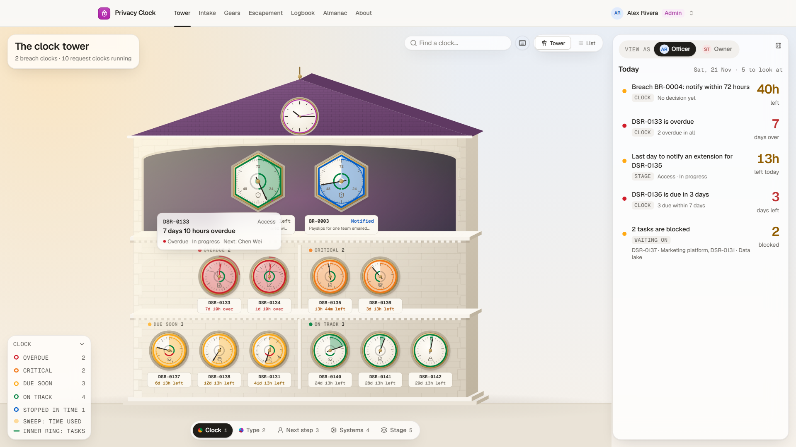

# Privacy Clock

One place for privacy requests and personal data breaches, each with its legal clock running. Log a data subject
request and its due date appears as you type the received date; report a breach and its 72-hour clock starts. Every
system that holds personal data goes to its owner as a task to search, export, erase or correct, and every step lands
in an append-only logbook, so the response can be defended later.




## This repository

```text
apps/privacy-clock/   the app: React + Vite frontend, Rayfin data model (rayfin/), tests, demo walkthrough
shared/         shared package (@x10/shared): data store, sign-in runtime, UI kit, charts
tools/          deploy, seed, SQL and secrets-check scripts
```

Quick start (no Fabric tenant needed, runs in demo mode with sample data):

```bash
npm install
npm run dev
```

## The problem and the rule it supports

Under the GDPR a data subject request (access, erasure, rectification, portability, objection, restriction) must be
answered within **one month of receipt** (Art. 12(3)), extendable by **two further months** for complex or numerous
requests if the person is told within the first month. A personal data breach must be reported to the supervisory
authority within **72 hours** of becoming aware of it (Art. 33(1)), and **every** breach must be documented, even when
it is not reported (Art. 33(5)). High-risk breaches are also told to the people affected (Art. 34). Most teams track
all this in a shared inbox, and the clocks are discovered when they have already run out.

Privacy Clock supports that process. It is not legal advice and does not replace the judgement of your data
protection officer or counsel. The statutory figures live in [`src/config.ts`](apps/privacy-clock/src/config.ts).

## What it looks like

**The clock tower.** A stone tower lit from the upper left, with one dial per open item: requests are round dials on
the floors, breaches are larger hexagonal dials in the belfry. Each dial's tinted sweep and hand show how much of the
legal time is used, its rim carries the lens colour, its inner ring has a segment per task (done, open, blocked), and
overdue dials crack while their hand ticks red. The clock in the gable is now, the time every dial is measured against.

- **Lenses** (keys 1–5): clock state, type, next step (who holds it), systems (where each request is waiting), stage.
  Each regroups the floors into bays and recolours the rims.
- **View as** (V): privacy officer or system owner; clocks without a task for the owner step back, and **Today**
  ranks the three to five things that need attention now: the running breach, the most overdue request, the request
  on its last day to notify an extension, the next one due within 7 days, blocked tasks. Each item flies to its dial.
- **Tools:** **Intake** (log a request with the due date and a two-month calendar computed live, or report a breach
  with its 72-hour deadline), **Gears** (the task board by system; each system's gear turns a tooth per task done),
  **Escapement** (breach assessment: the 72-hour bar ticking to the second, scope, risk, decision, notifications,
  contain, close), **Logbook** (every event per item, in order, printable), **Almanac** (on-time rate by month, days
  to close against the one-month line, requests by type, every breach against 72 hours). Each request has its own page
  with the clock bar, tasks, and the officer's controls (verify identity, move stage, extend, close, refuse).
- **Fallbacks:** the tower is SVG (no WebGL needed; `?nowebgl` shows the same tower), **L** switches to a sortable
  table of the same clocks with countdowns, reduced motion stops the sweeps, ticking and pulses, `?` lists the keyboard
  shortcuts, and the Logbook prints as a document. Screens for every page, both themes, desktop and phone:
  [docs/redesign](apps/privacy-clock/docs/redesign).

Demo walkthrough script: [demo/walkthrough.ts](apps/privacy-clock/demo/walkthrough.ts) (about two minutes; record with
`npx tsx tools/demo/record.ts privacy-clock` from the repo root).

## Prerequisites

- A Fabric tenant with the **Fabric Apps** workload enabled.
- A workspace on a Fabric capacity, and **Edit** (Contributor or higher) permission on it to deploy.
- Node.js 20 or later.
- Users need access to the app item (workspace members get it by default). System owners and staff who report breaches
  need access too. SQL-only app, authenticated access only (no anonymous data access, no connector).

## Run locally

```bash
npm install            # once, at the repository root
cd apps/privacy-clock
npm run dev            # offline demo on http://localhost:5212 with seed data and a persona switcher
npm run dev:fabric     # rayfin dev: the real Rayfin backend and Fabric sign-in
npx tsc -b && npx vitest run && npx playwright test
SCREENSHOTS=1 npx playwright test e2e/screenshots.spec.ts   # rewrite docs/redesign/*.png
```

Demo personas (switch in the identity menu, or open with `?as=<sub>`):

| Persona | Sub | Role |
|---|---|---|
| Alex Rivera | `demo-officer-alex` | Privacy officer (admin) |
| Sam Taylor | `demo-owner-sam` | System owner: CRM, Support desk |
| Priya Nair | `demo-owner-priya` | System owner: HR suite, Payroll |
| Chen Wei | `demo-owner-chen` | System owner: Data lake, Marketing platform |
| Noor Haddad | `demo-staff-noor` | Staff (can report a breach) |

## Deploy

```bash
cd apps/privacy-clock
npx rayfin up --workspace-id <workspace-id>
```

`rayfin up` creates the app backend, the SQL database and its endpoint, applies the schema and row policies, builds
with `build:fabric` and uploads `dist/`.

## Seed and make an admin

Open the deployed app once (so your Person row exists), then from the repo root:

```bash
npm run seed:fabric -w apps/privacy-clock -- --admin-email you@yourorg.com
```

This loads the demo rows (skipped when the seed marker exists), maps the first persona (the privacy officer) to you
and sets `isAdmin = 1` on your Person row. Privacy officers are admins; to add another, run in the Fabric SQL editor:

```sql
UPDATE dbo.People SET isAdmin = 1 WHERE email = 'officer@yourorg.com';
```

To start without demo data, skip the seed, run only the SQL above, and add your systems on the Gears board.

## How it works

| Entity | What it holds |
|---|---|
| `PrivacyRequest` | ref (`DSR-0142`), type, pseudonymous subject label, channel, received, identity verified, due, extended due, extension reason and when the person was told, status, outcome, closed, owning officer |
| `BreachCase` | ref (`BR-0004`), title, awareness time, reporter, handling officer, data categories, approximate people and records, risk level and rationale, authority and people notified, authority reference, reasons for delay, decision, status |
| `DataSystem` | a system holding personal data, its owner and what it holds |
| `Task` | one action (search, export, erase, rectify, restrict, contain) on one system for a request or breach, its assignee, status, note, due |
| `Event` | the logbook: kind, time, author, text. Append-only |
| `Person`, `AppMarker` | shared identity and the seed marker |

**Rules** (pure functions in `src/domain/clock.ts` and `src/domain/rules.ts`, unit-tested across time zones):

1. Due date = received + 1 calendar month: the same day next month, or the last day of that month when the day does
   not exist (31 January → 28/29 February). The request is in time if closed by the end of that local day.
2. Extension: 1 or 2 calendar months from the original due date (same day rule), only with a reason (20+ characters)
   and only if the person was told on or before the original due date; an extension recorded after it is blocked.
3. Breach clock = awareness + 72 hours, exactly. A decision is required before closing; "document only" needs a risk
   rationale of 40+ characters; past 72 hours without notification the case shows "late: reasons for delay required".
   A notify decision also needs the notification recorded before closing (and telling the people, for high risk).
4. Clock states: on track (> 50% of the time left), due soon (≤ 50%), critical (≤ 15%, or under 24 hours for a
   breach), overdue. The clock never pauses; the officer can log the verification date as the received date where
   guidance allows.
5. Every status change writes an Event; events are never edited or deleted.
6. An erasure request cannot close while any of its erase tasks is open or blocked.

**Security model.** Everyone signed in reads everything (requests carry a pseudonymous label, not an identity).

| Entity | Create | Update | Delete |
|---|---|---|---|
| PrivacyRequest | `ownerSub = caller` and status `new`; extension and closing fields excluded | `ownerSub = caller`; `ref`, `type`, `receivedAt`, `dueAt`, `ownerSub` frozen | nobody |
| BreachCase | `reportedBy = caller`, status `open`, decision `pending`; assessment and notification fields excluded | `officerSub = caller`; `ref`, `reportedBy`, `officerSub` frozen | nobody |
| DataSystem | `officerSub = caller` | `officerSub = caller` | nobody |
| Task | `officerSub = caller` and status `open` | `assigneeSub = caller` or `officerSub = caller`; parent, action and officer frozen | nobody |
| Event | `bySub = caller` | nobody | nobody |
| Person | own row, `isAdmin` excluded | own row, `isAdmin` and `sub` excluded | nobody |

In the domain (`src/domain/access.ts`, both demo and Fabric mode): only privacy officers (admins) log requests, change
them, assess breaches and add systems; only the owning officer changes a request or breach; only the assignee
completes, blocks or unblocks a task; only the handling officer reassigns one; anyone may report a breach, which is
handed to the reporter if they are an officer, otherwise to the first officer.

## Known limits

- There is no admin claim in Fabric Apps, so "is a privacy officer" is checked in the app, not the database. Through
  the API, a signed-in non-officer could create a request owned by themselves, or report a breach naming themselves as
  the handling officer, and then edit that row. The app flags both ("Owner/Handler is not a privacy officer") and the
  logbook shows who did what. Full enforcement needs dynamic auth claims (`udf.authClaims`); see Later.
- One update policy covers a task's assignee and its officer, so the database cannot stop an assignee changing a task's
  title, due date or assignee; the app only lets them change status and note.
- Event times are written by the client; the app always stamps the current time, but a crafted API call could backdate
  an event its author writes (never someone else's).
- Due dates use the officer's browser time zone at intake. Breach clocks are exact instants and do not depend on it.
- No public intake form (needs anonymous access), no templated responses, no Microsoft Purview integration yet.

## Later

- A public request form (needs anonymous data access).
- Templated responses per request type, with the outcome text filled in.
- Microsoft Purview integration to find the systems holding a subject's data.
- Database-level officer checks with dynamic auth claims.

## Gallery

**Title:** Birthday Bash: Privacy Clock

**Blurb (80 words):** Privacy Clock puts every data subject request and personal data breach on one clock tower, each
dial running down its legal deadline: one calendar month for requests, with the end-of-month rule and the two-month
extension, and 72 hours for breaches. System owners get their search, export and erase tasks on the Gears board, the
Escapement walks a breach from assessment to notification, and every step lands in a logbook nobody can edit. Built on
Fabric Apps with row-level security.

**Tags:** Partner | Birthday Bash, Fabric Apps, GDPR, Privacy, Data protection, Compliance, SQL database, AI at Work

## License

MIT. See [LICENSE](LICENSE).
